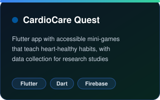
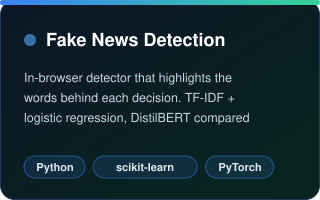
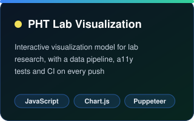

<div align="center">


<a href="https://gorintlapavanprasad.github.io">
  
</a>

</div>

<br/>

<div align="center">

<h1 align="center">Hi, I'm Pavan 👋</h1>

<p align="center">
I build software where <b>health, data and machine learning</b> meet: accessible Flutter games for cardiovascular research, explainable NLP, and interactive visualizations.
</p>

<p align="center">
<a href="https://gorintlapavanprasad.github.io"></a>
<a href="https://www.linkedin.com/in/pavan-gorintla/"></a>
<a href="https://gorintlapavanprasad.github.io/files/Pavan_Gorintla_CV.pdf"></a>
<a href="https://gorintlapavanprasad.github.io/portfolio/research.html"></a>
</p>

</div>

<br/>

## ✨ Featured work

<div align="center">

<a href="https://github.com/gorintlapavanprasad/CardioCare-Quest"></a>
<a href="https://github.com/gorintlapavanprasad/fake-news-detection"></a>
<a href="https://github.com/gorintlapavanprasad/Interactive-Visualization-PHT-Lab-Model"></a>

</div>

<br/>

## 🧰 Toolbox

<div align="center">

<b>Languages</b>

<table align="center"><tr>
<td align="center" width="100"><br/><sub><b>Java</b></sub></td>
<td align="center" width="100"><br/><sub><b>Python</b></sub></td>
<td align="center" width="100"><br/><sub><b>JavaScript</b></sub></td>
<td align="center" width="100"><br/><sub><b>C</b></sub></td>
<td align="center" width="100"><br/><sub><b>C++</b></sub></td>
<td align="center" width="100"><br/><sub><b>Dart</b></sub></td>
<td align="center" width="100"><br/><sub><b>PHP</b></sub></td>
<td align="center" width="100"><br/><sub><b>HTML5</b></sub></td>
<td align="center" width="100"><br/><sub><b>CSS3</b></sub></td>
</tr></table>

<b>Backend & DevOps</b>

<table align="center"><tr>
<td align="center" width="100"><br/><sub><b>Spring Boot</b></sub></td>
<td align="center" width="100"><br/><sub><b>Gradle</b></sub></td>
<td align="center" width="100"><br/><sub><b>PostgreSQL</b></sub></td>
<td align="center" width="100"><br/><sub><b>Node.js</b></sub></td>
<td align="center" width="100"><br/><sub><b>Express</b></sub></td>
<td align="center" width="100"><br/><sub><b>Firebase</b></sub></td>
<td align="center" width="100"><br/><sub><b>Docker</b></sub></td>
<td align="center" width="100"><br/><sub><b>Kubernetes</b></sub></td>
<td align="center" width="100"><br/><sub><b>Jenkins</b></sub></td>
</tr></table>

<b>Frontend, Viz & Design</b>

<table align="center"><tr>
<td align="center" width="100"><br/><sub><b>React</b></sub></td>
<td align="center" width="100"><br/><sub><b>Bootstrap</b></sub></td>
<td align="center" width="100"><br/><sub><b>jQuery</b></sub></td>
<td align="center" width="100"><br/><sub><b>D3.js</b></sub></td>
<td align="center" width="100"><br/><sub><b>Flutter</b></sub></td>
<td align="center" width="100"><br/><sub><b>Figma</b></sub></td>
<td align="center" width="100"><br/><sub><b>Unity</b></sub></td>
</tr></table>

<b>AI & Tools</b>

<table align="center"><tr>
<td align="center" width="100"><br/><sub><b>TensorFlow</b></sub></td>
<td align="center" width="100"><br/><sub><b>PyTorch</b></sub></td>
<td align="center" width="100"><br/><sub><b>Git</b></sub></td>
<td align="center" width="100"><br/><sub><b>GitHub</b></sub></td>
<td align="center" width="100"><br/><sub><b>GitLab</b></sub></td>
<td align="center" width="100"><br/><sub><b>LaTeX</b></sub></td>
<td align="center" width="100"><br/><sub><b>VS Code</b></sub></td>
<td align="center" width="100"><br/><sub><b>Linux</b></sub></td>
</tr></table>

<sub>Also: Swagger · Flyway · JPA · Spring Security · REST microservices · Highcharts · Plotly · Twine · GPT / Gemini / Llama / Mistral APIs · RAG · WCAG 2.1 AA · Agile / Scrum</sub>

</div>

<br/>

## 📈 Activity

<div align="center">


<br/><br/>

<picture>
  <source media="(prefers-color-scheme: dark)" srcset="https://raw.githubusercontent.com/gorintlapavanprasad/gorintlapavanprasad/output/github-contribution-grid-snake-dark.svg">
  <source media="(prefers-color-scheme: light)" srcset="https://raw.githubusercontent.com/gorintlapavanprasad/gorintlapavanprasad/output/github-contribution-grid-snake.svg">
  
</picture>

</div>

<br/>

<details>
<summary><b>⌨️ Terminal view</b></summary>

```text
██████╗  █████╗ ██╗   ██╗ █████╗ ███╗   ██╗
██╔══██╗██╔══██╗██║   ██║██╔══██╗████╗  ██║
██████╔╝███████║██║   ██║███████║██╔██╗ ██║
██╔═══╝ ██╔══██║╚██╗ ██╔╝██╔══██║██║╚██╗██║
██║     ██║  ██║ ╚████╔╝ ██║  ██║██║ ╚████║
╚═╝     ╚═╝  ╚═╝  ╚═══╝  ╚═╝  ╚═╝╚═╝  ╚═══╝

gorintlapavanprasad@github
--------------------------
Role ....... Full-stack & Flutter developer
Focus ...... Health tech, ML, data viz
Stack ...... Java, Python, JS, Dart, Spring Boot, Flutter
$ whoami
> builds things that help people
```

</details>

<div align="center">
<br/>

</div>
